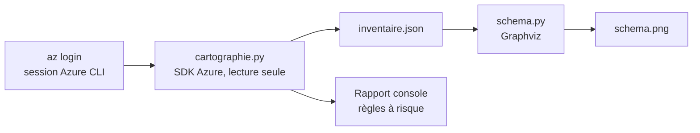
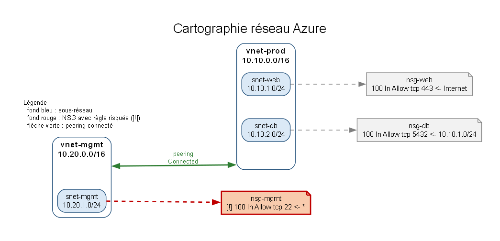

# Cartographie réseau Azure

Outil en Python qui **inventorie la couche réseau d'un environnement Azure**, **détecte les règles de pare-feu (NSG) trop permissives** et **génère un schéma** de l'architecture.

> **English summary** – A Python tool that inventories the network layer of an Azure subscription (virtual networks, subnets, peerings, network security groups), flags inbound rules open to the Internet on sensitive ports, and draws the architecture with Graphviz. Built as a personal learning project to understand how a cloud environment can be mapped from a security-audit perspective. Documentation below is in French.

---

## Sommaire

1. [Contexte et objectifs](#1-contexte-et-objectifs)
2. [Fonctionnement](#2-fonctionnement)
3. [Structure du dépôt](#3-structure-du-dépôt)
4. [Prérequis](#4-prérequis)
5. [Installation pas à pas (Windows)](#5-installation-pas-à-pas-windows)
6. [Environnement de test Azure](#6-environnement-de-test-azure)
7. [Utilisation](#7-utilisation)
8. [Résultat obtenu](#8-résultat-obtenu)
9. [Explication du code](#9-explication-du-code)
10. [Tests](#10-tests)
11. [Difficultés rencontrées et solutions](#11-difficultés-rencontrées-et-solutions)
12. [Limites](#12-limites)
13. [Pistes d'amélioration](#13-pistes-damélioration)
14. [Sécurité et nettoyage](#14-sécurité-et-nettoyage)
15. [Méthode de travail](#15-méthode-de-travail)

---

## 1. Contexte et objectifs

Dans un audit de sécurité cloud, l'une des premières étapes consiste à **comprendre l'architecture auditée** : quels réseaux existent, comment ils sont découpés, comment ils communiquent et quelles règles de filtrage s'appliquent. Dans un grand environnement, cette cartographie manuelle est longue et sujette aux oublis.

Ce projet est une première brique d'apprentissage qui répond à trois objectifs :

- **Cartographier** : lister les réseaux virtuels, sous-réseaux, peerings et NSG d'un environnement Azure, et comprendre les liens entre ces ressources ;
- **Détecter** : repérer automatiquement des mauvaises configurations classiques (par exemple SSH ouvert à tout Internet) ;
- **Visualiser** : produire un schéma lisible, avec les points à risque mis en évidence.

L'approche est de type **boîte grise** : l'outil lit la configuration via l'API Azure avec un compte en lecture seule, sans toucher aux ressources.

## 2. Fonctionnement



1. `cartographie.py` s'authentifie avec la session `az login`, lit l'abonnement (ou un groupe de ressources), affiche un rapport dans la console et écrit `inventaire.json`.
2. `schema.py` lit `inventaire.json` et dessine le schéma `schema.png` avec Graphviz.

**Règles détectées.** Une règle est signalée si elle est *entrante*, en *autorisation*, depuis une source ouverte (`*`, `0.0.0.0/0`, `Internet`, `Any`) et qu'elle concerne :

| Cas | Message |
|---|---|
| Tous les ports (`*`) | tous les ports ouverts depuis Internet |
| 22 | SSH ouvert depuis Internet |
| 3389 | RDP ouvert depuis Internet |
| 445 | SMB ouvert depuis Internet |
| 1433 | SQL Server ouvert depuis Internet |
| 3306 | MySQL ouvert depuis Internet |
| 5432 | PostgreSQL ouvert depuis Internet |
| 27017 | MongoDB ouvert depuis Internet |

Les plages de ports (par exemple `20-30`) sont prises en compte.

## 3. Structure du dépôt

```
.
├── cartographie.py      # inventaire Azure + détection des règles risquées
├── schema.py            # génération du schéma Graphviz
├── test_detection.py    # tests unitaires de la logique de détection
├── requirements.txt     # dépendances Python
├── schema.png           # exemple de schéma généré
├── .gitignore
└── README.md
```

## 4. Prérequis

- Windows 10 ou 11 (les commandes ci-dessous sont en PowerShell ; l'outil fonctionne aussi sous Linux)
- Python 3.10 ou plus récent
- [Azure CLI](https://learn.microsoft.com/cli/azure/install-azure-cli)
- [Graphviz](https://graphviz.org/download/) (commande `dot`)
- Git
- Un compte Azure avec le rôle **Lecteur** (Reader) minimum sur la cible analysée

## 5. Installation pas à pas (Windows)

**1. Installer les outils** (PowerShell, une commande à la fois) :

```powershell
winget install -e --id Python.Python.3.12
winget install -e --id Microsoft.AzureCLI
winget install -e --id Graphviz.Graphviz
winget install -e --id Git.Git
```

Fermer puis rouvrir PowerShell, puis vérifier :

```powershell
python --version
az version
dot -V
git --version
```

**2. Récupérer le projet et créer l'environnement virtuel :**

```powershell
git clone https://github.com/SALIHSIDIBE/azure-network-mapper.git
cd azure-network-mapper
python -m venv .venv
.\.venv\Scripts\Activate.ps1
pip install -r requirements.txt
```

Si PowerShell bloque l'activation de l'environnement virtuel :

```powershell
Set-ExecutionPolicy -Scope CurrentUser RemoteSigned
```

**3. Se connecter à Azure :**

```powershell
az login
az account show
```

`az account show` doit afficher l'abonnement visé avec `"state": "Enabled"`. Pour changer d'abonnement : `az account set --subscription "nom-de-l-abonnement"`.

## 6. Environnement de test Azure

Pour développer et valider l'outil, j'ai déployé un petit environnement dans un groupe de ressources dédié. Il ne contient que des réseaux virtuels, sous-réseaux, NSG et peerings, des ressources normalement **non facturées** (à vérifier dans la grille tarifaire Azure). Il n'y a ni machine virtuelle ni adresse IP publique.

**Architecture déployée :**

| Réseau | Plage | Sous-réseau | NSG associé | Règle |
|---|---|---|---|---|
| `vnet-prod` | 10.10.0.0/16 | `snet-web` (10.10.1.0/24) | `nsg-web` | HTTPS (443) depuis Internet |
| `vnet-prod` | 10.10.0.0/16 | `snet-db` (10.10.2.0/24) | `nsg-db` | PostgreSQL (5432) uniquement depuis `snet-web` |
| `vnet-mgmt` | 10.20.0.0/16 | `snet-mgmt` (10.20.1.0/24) | `nsg-mgmt` | **SSH (22) depuis n'importe où** (volontairement vulnérable) |

Les deux réseaux sont reliés par un **peering** dans les deux sens. La règle SSH de `nsg-mgmt` est une mauvaise configuration **volontaire**, créée pour vérifier que l'outil la détecte. Aucune machine n'est déployée derrière : elle n'expose rien en réalité.

**Commandes de déploiement :**

```powershell
az group create --name rg-cartographie --location francecentral

# Réseau de production
az network vnet create -g rg-cartographie -n vnet-prod --address-prefixes 10.10.0.0/16 --subnet-name snet-web --subnet-prefixes 10.10.1.0/24
az network vnet subnet create -g rg-cartographie --vnet-name vnet-prod -n snet-db --address-prefixes 10.10.2.0/24

# NSG web et base de données
az network nsg create -g rg-cartographie -n nsg-web
az network nsg rule create -g rg-cartographie --nsg-name nsg-web -n allow-https --priority 100 --direction Inbound --access Allow --protocol Tcp --source-address-prefixes Internet --destination-port-ranges 443
az network nsg create -g rg-cartographie -n nsg-db
az network nsg rule create -g rg-cartographie --nsg-name nsg-db -n allow-postgres-from-web --priority 100 --direction Inbound --access Allow --protocol Tcp --source-address-prefixes 10.10.1.0/24 --destination-port-ranges 5432
az network vnet subnet update -g rg-cartographie --vnet-name vnet-prod -n snet-web --network-security-group nsg-web
az network vnet subnet update -g rg-cartographie --vnet-name vnet-prod -n snet-db --network-security-group nsg-db

# Réseau de gestion + peering
az network vnet create -g rg-cartographie -n vnet-mgmt --address-prefixes 10.20.0.0/16 --subnet-name snet-mgmt --subnet-prefixes 10.20.1.0/24
az network vnet peering create -g rg-cartographie -n prod-to-mgmt --vnet-name vnet-prod --remote-vnet vnet-mgmt --allow-vnet-access
az network vnet peering create -g rg-cartographie -n mgmt-to-prod --vnet-name vnet-mgmt --remote-vnet vnet-prod --allow-vnet-access

# Mauvaise configuration volontaire : SSH ouvert à tout Internet
az network nsg create -g rg-cartographie -n nsg-mgmt
az network nsg rule create -g rg-cartographie --nsg-name nsg-mgmt -n allow-ssh-any --priority 100 --direction Inbound --access Allow --protocol Tcp --source-address-prefixes '*' --destination-port-ranges 22
az network vnet subnet update -g rg-cartographie --vnet-name vnet-mgmt -n snet-mgmt --network-security-group nsg-mgmt
```

**Vérifications :**

```powershell
az network vnet list -g rg-cartographie --output table
az network nsg list -g rg-cartographie --output table
az network vnet peering list -g rg-cartographie --vnet-name vnet-prod --output table
```

Le peering doit afficher l'état `Connected`.

## 7. Utilisation

```powershell
# 1. Inventaire et détection
python cartographie.py --groupe rg-cartographie

# 2. Schéma
python schema.py
```

**Options de `cartographie.py` :**

| Option | Description | Défaut |
|---|---|---|
| `--groupe` | limite l'analyse à un groupe de ressources | tout l'abonnement |
| `--sortie` | fichier JSON de sortie | `inventaire.json` |

**Options de `schema.py` :**

| Option | Description | Défaut |
|---|---|---|
| `--entree` | fichier d'inventaire à lire | `inventaire.json` |
| `--sortie` | nom du fichier image, sans extension | `schema` |

L'identifiant d'abonnement est lu dans la variable d'environnement `AZURE_SUBSCRIPTION_ID`, ou à défaut avec `az account show`. Il n'est jamais écrit dans le code ni dans l'inventaire.

**Exemple de sortie console sur l'environnement de test :**

```
=== Réseaux virtuels ===
- vnet-prod (10.10.0.0/16)
    sous-réseau snet-web 10.10.1.0/24  NSG : nsg-web
    sous-réseau snet-db 10.10.2.0/24  NSG : nsg-db
    peering prod-to-mgmt -> vnet-mgmt (Connected)
- vnet-mgmt (10.20.0.0/16)
    sous-réseau snet-mgmt 10.20.1.0/24  NSG : nsg-mgmt
    peering mgmt-to-prod -> vnet-prod (Connected)

=== Groupes de sécurité réseau ===
- nsg-web
    règle allow-https : Inbound Allow Tcp ports 443
- nsg-db
    règle allow-postgres-from-web : Inbound Allow Tcp ports 5432
- nsg-mgmt
    règle allow-ssh-any : Inbound Allow Tcp ports 22
      ATTENTION : SSH (port 22) ouvert depuis Internet

1 problème(s) détecté(s).
```

## 8. Résultat obtenu



- les réseaux virtuels sont représentés par des cadres contenant leurs sous-réseaux ;
- chaque sous-réseau est relié par un trait en pointillés à son NSG ;
- les NSG contenant une règle risquée apparaissent **en rouge**, avec la marque `[!]` sur la règle concernée ;
- le peering entre réseaux est une flèche verte quand il est dans l'état `Connected`.

Sur l'environnement de test, l'outil détecte bien et uniquement la règle SSH volontairement ouverte de `nsg-mgmt` : la règle HTTPS (443) et la règle PostgreSQL limitée au sous-réseau web ne sont pas signalées.

## 9. Explication du code

### `cartographie.py`

| Fonction | Rôle |
|---|---|
| `recuperer_id_abonnement()` | lit l'identifiant d'abonnement (variable d'environnement ou `az account show`) |
| `collecter(client, groupe)` | interroge le SDK Azure et construit l'inventaire (réseaux, sous-réseaux, peerings, NSG et règles) |
| `analyser_regle(regle)` | retourne la liste des problèmes d'une règle NSG |
| `port_couvert(spec, port)` | indique si une spécification de port (`*`, `22`, `20-30`) couvre un port donné |
| `valeur(x)` | lit la valeur texte d'une énumération du SDK Azure (voir section 11) |
| `afficher(inventaire)` | affiche le rapport console |

L'authentification utilise `AzureCliCredential` : l'outil réutilise la session `az login`, sans mot de passe ni clé dans le code. Les appels (`virtual_networks.list_all()` et `network_security_groups.list_all()`) sont **en lecture seule**.

### `schema.py`

Il lit l'inventaire et construit un graphe Graphviz : un cadre (`cluster`) par réseau virtuel, un nœud par sous-réseau et par NSG, un lien sous-réseau vers NSG, et une flèche pour chaque peering (double si le peering existe dans les deux sens). Les NSG à risque sont colorés en rouge.

## 10. Tests

`test_detection.py` vérifie la logique de détection **sans connexion Azure**, avec de fausses règles qui imitent celles du SDK (y compris ses énumérations) :

```powershell
python -m unittest -v
```

Cas couverts : SSH ouvert à tout Internet (signalé), règle de refus (ignorée), règle sortante (ignorée), source interne (ignorée), HTTPS depuis Internet (ignoré), tous les ports (signalé), plage de ports couvrant SSH (signalée), lecture des énumérations et extraction des identifiants Azure.

## 11. Difficultés rencontrées et solutions

| Problème | Cause | Solution |
|---|---|---|
| `az` et `dot` « non reconnus » dans PowerShell | programmes installés mais pas encore dans le `PATH` de la session | rouvrir PowerShell après l'installation, ou ajouter les dossiers au `PATH` |
| Activation de l'environnement virtuel bloquée | politique d'exécution de PowerShell | `Set-ExecutionPolicy -Scope CurrentUser RemoteSigned` |
| **Détection à 0 problème alors qu'une règle SSH ouverte existait** | le SDK Azure renvoie des **énumérations** ; avec cette version de Python, `str()` donne `SecurityRuleAccess.ALLOW` au lieu de `Allow`, donc les comparaisons échouaient et toutes les règles étaient ignorées | fonction `valeur()` qui lit l'attribut `.value` de l'énumération ; test unitaire ajouté avec de vraies énumérations |

Le troisième point est un bon exemple de ce que j'ai retenu : un résultat « 0 problème » n'est pas forcément un bon résultat, il faut le confronter à ce qu'on sait être présent dans l'environnement. C'est pour cela que l'environnement de test contient une mauvaise configuration volontaire.

## 12. Limites

Cet outil est un support d'apprentissage, pas un outil d'audit complet.

- Il ne couvre que la couche réseau : pas de machines virtuelles, d'adresses IP publiques, de comptes de stockage, de Key Vault, ni de rôles et permissions.
- Il ne tient pas compte de l'ordre des priorités entre règles : une règle de refus de priorité plus haute qui neutraliserait une règle d'autorisation risquée n'est pas prise en compte (faux positifs possibles).
- Il ne signale que les sources `*`, `0.0.0.0/0`, `Internet` et `Any` ; les étiquettes de service (par exemple `AzureCloud`) et les adresses IPv6 ne sont pas analysées.
- Les règles par défaut d'Azure et les groupes de sécurité d'application ne sont pas interprétés.
- Un seul abonnement à la fois.
- Il n'a été testé que sur un petit environnement de laboratoire.

## 13. Pistes d'amélioration

- Ajouter les machines virtuelles, interfaces réseau et adresses IP publiques, pour savoir si une règle ouverte expose réellement une machine ;
- Prendre en compte la priorité des règles et les étiquettes de service ;
- Exporter un rapport lisible (Markdown ou HTML) avec un niveau de gravité par constat ;
- Supporter plusieurs abonnements ;
- Étendre l'analyse à d'autres fournisseurs (AWS, GCP) ;
- Ajouter des tests sur des environnements plus grands.

## 14. Sécurité et nettoyage

- **Aucun secret dans le dépôt** : l'authentification passe par la session `az login`. Le `.gitignore` exclut l'environnement virtuel, les caches Python, les fichiers `.env` et `inventaire.json`.
- **Ne pas publier** de captures ou de fichiers contenant des identifiants d'abonnement.
- **Lecture seule** : l'outil ne modifie aucune ressource.
- **Nettoyer l'environnement de test** après utilisation pour éviter toute consommation inutile :

```powershell
az group delete --name rg-cartographie
```

## 15. Méthode de travail

Ce projet a été réalisé dans une démarche d'apprentissage : déploiement de l'environnement Azure, exécution et vérification de chaque étape, puis analyse des résultats. J'ai été accompagné par un assistant d'IA (Claude) pour structurer le code, expliquer les concepts Azure et corriger des erreurs. J'ai lu, exécuté et testé chaque script, et je continue à approfondir Python : certaines parties du code reflètent encore mon niveau de débutant, que je compte améliorer.

---

*Projet personnel d'apprentissage – Sâlih SIDIBE, Mastère 2 Cybersécurité Systèmes & Réseaux, INGETIS Paris.*
